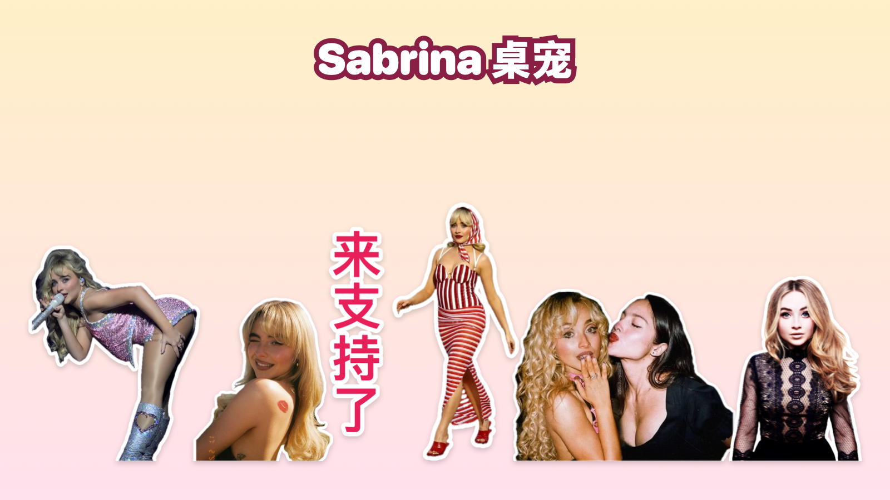

# Sabrina 桌宠

把 Sabrina Carpenter 做成了 Mac 桌宠，关键词是「霍尼」和「甜心」：她平时是一张表情包贴纸，站在你的桌面上走来走去，会理你、会睡觉、能被拎起来扔出去，点一下按钮还能演她的各种名场面



作者：Gabriel Xie（小红书 **@盖比Gabe**，关注他看更多歌手桌宠）

> 粉丝向的非官方作品，与 Sabrina Carpenter 本人及其团队、唱片公司没有任何关系

## 按钮

她头顶有一排按钮：

| 按钮 | 作用 |
|---|---|
| 霍尼匠妹 | 在霍尼系列表情包之间切换，其中「舔嘴唇」「扭一扭」两张是会动的 |
| 甜心匠妹 | 在甜心系列表情包之间切换，默认形象是左边写着「来支持了」的那张 |
| 伪人匠妹 | 在伪人系列表情包之间切换 |
| 匠娅久久 | 匠妹和娅娅的合照，每换一张两个人说一句话 |
| 喷泉 | 科切拉被喷泉浇湿的名场面 |
| Juno | 弹出菜单选一段 Juno，一共十五段，每段配一句字幕，也可以随机来一个 |
| 男人音 | 唱 Manchild 时的超绝男人音（带中英字幕） |
| 伪人变脸 | 剧里的假笑变脸名场面 |
| 反转 | 先是她被牵着头发，一翻过来变成她牵着别人的头发 |
| 专辑 | 专辑封面绕着她转圈，再一张张朝你的鼠标飞过去 |
| 散步 | 闲着的时候自己在屏幕底部走来走去 |
| 竖屏 | 只在屏幕最右边 9:16 的竖条里活动，方便录竖屏视频 |

她右脚边还有一个「唱男人音」按钮，点一下直接开唱

名场面都带原视频的声音，演的时候脚边会出现「停止」按钮，按钮条会自动挪到画面外面，不挡着她

## 惩罚动作

连戳她 5 下，或者两秒多里连点同一个表情包系列的按钮 5 下，她会被惹毛，演这个系列的「惩罚动作」：

| 系列 | 惩罚动作 |
|---|---|
| 霍尼匠妹 | 随机一段 Juno |
| 甜心匠妹 | 超绝男人音 |
| 伪人匠妹 | 伪人变脸 |
| 匠娅久久 | 有人冲出来挤到两人中间 |

## 互动

| 怎么做 | 她会怎样 |
|---|---|
| 拖着她走 | 像被拎住一样左右晃，停一下再松手，她就待在你放的位置 |
| 用力甩出去 | 飞出去、撞到屏幕边弹回来、落地压扁，摔得高了会头晕 |
| 鼠标在她上半身左右蹭 | 摸头：冒口红印、爱心和蜂蜜罐，换成开心的表情 |
| 鼠标靠近她 | 发现你了：跳一下、头上冒一颗心，身体往鼠标那边歪 |
| 什么都不做 | 她会自己说话、做鬼脸、转圈、跳到窗口顶上走来走去，偶尔还会自己演一段名场面 |
| 3 分钟不碰电脑 | 她睡着了，头上冒 Zzz，你一回来她就伸个懒腰跟你打招呼 |

右键她可以：调大小、开关声音、开关重力（关掉后拖到哪就停在哪）、开关睡觉、设置多久自己演一次名场面、打开录屏背景（一键遮住桌面上的窗口和图标只留壁纸，或者换成绿幕方便后期抠图）、退出

## 下载安装

1. 到本仓库右侧的 **Releases** 下载 `sabrina-pet-mac.zip`
2. 解压后把「Sabrina桌宠」拖进「应用程序」文件夹
3. 第一次打开会被系统拦下（这个 app 没有付费做苹果签名），这样放行：
   - 先双击打开一次，弹窗里点「完成」
   - 打开「系统设置 → 隐私与安全性」，拉到最下面，点「仍要打开」
4. 打开后她会出现在屏幕右下角，没有 Dock 图标，退出请右键她

系统要求：macOS 13 及以上，Apple 芯片和 Intel 芯片的 Mac 都可以用

## 自己编译

需要先装 Xcode 或 Xcode 命令行工具（终端运行 `xcode-select --install`），然后在项目目录里运行：

```bash
./build.sh sabrina
```

打包好的 app 在 `build/sabrina/Sabrina桌宠.app`，下载用的压缩包在 `build/sabrina/sabrina-pet-mac.zip`

这个仓库用的是通用的「歌手桌宠模板」：程序（`engine/main.swift`）所有歌手共用，每个歌手只需要一份配置（`singers/sabrina/pet.json5`，每一项都有中文注释）和一个素材文件夹，按钮、表情包、名场面、台词、配色都写在配置里，不用改程序

## 素材是怎么做的

`singers/sabrina/assets/` 里是已经处理好的素材，编译时直接用；原视频和原图没有放进仓库，每段素材用什么参数处理的写在 `singers/sabrina/make_assets.sh` 里

- 表情包：用 macOS 自带的主体识别把人抠出来，加一圈白色贴纸描边；会动的表情包是把几秒的短视频逐帧抠出来再描边
- 名场面：逐帧用主体识别找到她并跟踪，别人和杂物都去掉；镜头远近不同的片段按脸的大小统一缩放；原视频压在她身上的字幕单独抠出来放到脚下，身上的字擦掉补平
- Juno 合集：按每段底下的城市名自动分段，挑了十五段；视频作者加的标签擦掉，前排观众的头和手机去掉
- 喷泉：水花太多抠不干净，直接放原画面，四周淡出
- 反转、挤进来：用抠好的贴纸合成的动画，音效是程序生成的
- 加速：名场面用变速不变调加快，画面和声音一起加快，内容不剪

## 项目结构

```
engine/main.swift            桌宠本体（Swift + AppKit，单文件，所有歌手共用）
singers/sabrina/pet.json5    Sabrina 的配置：按钮、表情包、名场面、表情、台词、配色
singers/sabrina/assets/      处理好的贴纸、逐帧透明动画、声音、字幕
singers/sabrina/make_assets.sh  每段素材的处理命令
singers/_template/pet.json5  新歌手的配置模板
tools/                       素材处理工具（抠贴纸、抠名场面、描边、裁卡片、合成动画、调声音、生成图标）
build.sh                     编译打包：./build.sh sabrina
new_singer.sh                新建一个歌手的文件夹
```

## 素材来源与版权

- Sabrina Carpenter、Olivia Rodrigo、Joshua Bassett 的肖像、照片、专辑封面、演出和影视画面、音乐与音频，版权和肖像权归他们本人及相关权利方（唱片公司、电视台、流媒体平台、媒体）所有
- 用到的画面来自演唱会现场（网友拍摄）、颁奖礼、影视剧片段、专辑封面，以及小红书、X 上网友分享的表情包和剪辑
- 本项目仅供粉丝交流和学习，不得用于商业用途；如果你是相关权利方并希望删除素材，请提 Issue 联系，会尽快处理
- 代码部分以 MIT 协议开源，见 [LICENSE](LICENSE)，素材不在开源协议范围内

## 制作过程

整个桌宠是用 [Claude Code](https://claude.com/claude-code) vibe coding 做出来的：从抠图、字幕处理、合成动画，到桌宠的动画、物理和各种互动，都是通过对话一步步完成的，它的「姐姐」是 [Olivia 桌宠](https://github.com/gabrielxie55/olivia-pet)
